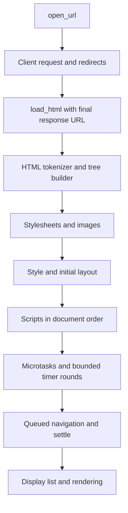

# Architecture and design rationale

[Project overview](../README.md) · [Usage and embedding](usage.md) ·
[Development](development.md) · [Limits and budgets](limits.md)

## Architectural boundaries

Sol is a collection of Rust crates coordinated by `sol_kernel::Page`. The
executable is one consumer of that API. HTML parsing, CSS selection, layout,
JavaScript evaluation, and painting remain usable without starting the remote
window server.

The crate boundaries keep different kinds of policy separate:

- `sol_url`, `sol_util`, and `sol_dom` provide shared representations and storage.
- `sol_html` and `sol_css` interpret document and style inputs.
- `sol_text`, `sol_layout`, and `sol_paint` turn those inputs into pixels.
- `sol_net` owns requests, redirects, cookies, caching, and resource batches.
- `sol_img` owns image format validation and pixel buffers.
- `sol_js` evaluates scripts and exposes host callbacks for browser operations.
- `sol_kernel` decides when these components run and which state they share.
- `sol` adapts the kernel to commands and the remote window protocol.
- `sol_tls` is a separate experimental implementation. Browser HTTPS uses
  ureq/rustls and does not fall back to `sol_tls` after verification failure.

These are conceptual responsibilities rather than a strict dependency stack.
For example, `sol_img` depends on `sol_net` for its bounded in-tree inflater.
Cargo manifests are authoritative for exact build dependencies; do not infer that
an image decode performs networking from that dependency alone.

## Page ownership and module layout

[`Page`](../crates/kernel/src/lib.rs) owns the active document, JavaScript realm,
network client, fonts, stylesheets, image storage, layout output, display list,
interaction state, navigation queue, and console output.

| Module | Policy boundary | Reason for the boundary |
|---|---|---|
| [`navigation`](../crates/kernel/src/navigation.rs) | Document loads, script order, URL resolution, queued locations | Document replacement and execution order must be coordinated |
| [`resources`](../crates/kernel/src/resources.rs) | Stylesheet collection and image loading | Fetch parallelism must preserve cascade order and memory accounting |
| [`runtime`](../crates/kernel/src/runtime.rs) | Host callbacks, settling, timer rounds | Script callbacks need a controlled return point before navigation and refresh |
| [`rendering`](../crates/kernel/src/rendering.rs) | Style, layout, display lists, pixels, hit testing | Painted geometry and interactive geometry must use the same transforms |
| [`interaction`](../crates/kernel/src/interaction.rs) | Pseudo-state and input dispatch | Input can affect both script-visible state and CSS matching |

The modules are private. Public methods remain callable through `Page`, and
`Interact` is re-exported from the crate root. Methods needed by sibling modules
use `pub(super)` rather than exposing implementation stages as new module APIs.

The document is `Rc<RefCell<Document>>`. JavaScript bindings and the kernel can
refer to the same live document without copying it. Loading HTML replaces the
contents of that shared allocation. Replacing the allocation itself would leave
existing holders attached to the old document.

The geometry map, client, console, and navigation queue also use shared handles.
Runtime closures capture those handles rather than a long-lived mutable borrow
of `Page`. Borrow scopes must end before evaluating JavaScript: a callback can
access the same `RefCell` through the runtime and otherwise trigger a borrow panic.

This ownership model is local to a rendering thread. Resource workers share
network infrastructure through the client's thread-safe internals; the page and
its `Rc` state are not a transferable browser session.

## Document lifecycle

The main pipeline is:

`open_url` rejects main-document HTTP statuses of 400 or higher. The final
response URL becomes the page URL, so relative references follow the destination
of a redirect. Standalone image responses are rejected as documents; images can
be loaded through ``.

`load_html` resets the document, clears author stylesheets and decoded images,
and removes existing event listeners. It reuses the page's client, fonts, and
JavaScript realm. This is not the same as constructing a fresh browser context:
JavaScript globals and some runtime state can survive a load. Use a new `Page`
when the caller needs an independent realm.

The HTML tree builder returns script node IDs for later execution. The kernel
performs initial style/layout before evaluating them so geometry queries have a
snapshot to consult. Scripts run after parsing rather than pausing the HTML
parser at each script element. External scripts are fetched and executed in
document order; the kernel does not implement a full async/defer/module scheduler.
A `type="module"` script is accepted by the existing evaluator, not a separate
module loading system.

Recoverable script and subresource failures are appended to the page console.
A successful document load therefore does not imply that every image, stylesheet,
or script succeeded. The console is part of the diagnostic result.

## Refresh and event turns

[`Js::eval`](../crates/js/src/lib.rs) drains microtasks after script evaluation.
`Page::settle` drains them again, pumps up to four timer rounds, refreshes styles
and layout when invalidation is observed, and applies queued navigation. Initial
loading also pumps up to eight rounds before its subsequent settle call.

A timer round is not a real-time scheduling guarantee. The kernel sleeps briefly
between some rounds and never waits for all future timers to become due.
JavaScript evaluation and the `fetch` host callback are synchronous; an individual
script or callback has no general execution-time limit. Microtask draining has a
callback-count guard, not a timeout on each callback.

Location setters enqueue strings. The kernel snapshots that queue before
processing it so a document load can enqueue further work without borrowing the
queue recursively. After a full navigation it returns from the current queue
iteration. Nested page loading can itself evaluate scripts and process queues;
this is not a global navigation-depth bound.

The DOM's mutation methods mark dirty flags. `settle` aggregates those flags and
performs a full style and layout rebuild when needed. The current optimization
is avoiding rebuilds on clean turns; it is not subtree-only incremental layout.
Interaction changes can also force invalidation through page state.

Direct mutation through public fields or `Document::node_mut` can bypass the
usual invalidation and index maintenance. Embedders must preserve those invariants
or use the document's mutation helpers. Direct edits to viewport or pseudo-state
should be followed by explicit style/layout refresh when necessary.

## Resource ordering and memory ownership

Stylesheet fetches can overlap, but cascade order must follow document order.
The kernel records inline sources and linked-source positions before fetching,
then assembles CSS by those positions. Repeated links can share a network fetch
without losing their separate positions relative to other sheets. A combined
16 MiB author-CSS budget limits retained source text.

Image URLs are normalized without fragments and grouped with their consumers.
A single decoded `Rc<Image>` can serve several elements. Intrinsic dimensions
are available to layout before scripts run. Images are processed in chunks of
32 unique jobs so the page does not retain every encoded response at once.
The decoded page budget charges shared pixel storage once per unique image.

Image and stylesheet discovery occurs during loading. A later script that adds
an `` or stylesheet does not cause `settle` to repeat resource discovery;
it only triggers the style/layout refresh path. A dynamic resource loader would
need an explicit owner and lifecycle beyond dirty-flag handling.

## Request policy versus transport

The [`network crate root`](../crates/net/src/lib.rs) owns client configuration,
cache lookup, redirects, method rewrites, and unsafe-method invalidation.
[`transport`](../crates/net/src/transport.rs) builds requests and exchanges bytes
through ureq. Automatic redirects are disabled there so every hop goes through
the client's credential, origin, scheme, and method rules.

| Module | Reason to change it |
|---|---|
| [`body`](../crates/net/src/body.rs) | Adjust shared bounded-read behavior |
| [`cookies`](../crates/net/src/cookies.rs) | Change cookie parsing, scope, expiry, or request matching |
| [`encoding`](../crates/net/src/encoding.rs) | Change text/base64 interpretation |
| [`local`](../crates/net/src/local.rs) | Change file/data URL behavior |
| [`response`](../crates/net/src/response.rs) | Change metadata or response text helpers |
| [`resources`](../crates/net/src/resources.rs) | Change cache admission, freshness, batches, or their budgets |
| [`inflate`](../crates/net/src/inflate.rs) | Change the shared bounded DEFLATE implementation used by codecs |

The pooled agent captures TLS verification and timeout settings. Because those
client fields are mutable, the transport recreates the agent when either changes.
`set_proxy` also discards the existing agent and clears the shared cache.

Body reading distinguishes a body exactly at the limit from one over it by
reading at most one extra byte. Deflate responses have a separate decoded-output
check; wire size cannot establish the allocation needed after decompression.
Local file reads use the same bounded-read helper, and data URLs preserve binary
bytes rather than passing them through lossy text decoding.

## Cache identity and freshness

The shared cache admits a conservative subset of GET responses. Its identity
includes the normalized URL, TLS verification mode, user agent, and sorted
request/extra headers. Credentialed, cookie-bearing, range, conditional, and
explicit cache-control requests bypass it. Responses with `Set-Cookie`, `Vary: *`,
private/no-store/no-cache directives, or unsupported status are not retained.

Freshness requires explicit `max-age` or `Expires`. `Date`, `Age`, and elapsed
request time reduce the remaining lifetime; the remaining lifetime is capped at
one hour. Lookup uses monotonic time and updates the returned `Age` header.
Expired entries are removed instead of revalidated.

The cache holds at most 128 entries and 32 MiB of bodies, with LRU eviction.
Successful methods other than GET/HEAD invalidate cached representations of their
target. Redirect destinations are not stored under the original request URL.
`clear_cache` resets both entries and counters. `cache_stats` reports cache
activity, not the total number of network requests or all process allocations.

## Parallel batches

`Client::get_many` deduplicates fragment-free URLs and returns one result per input
position. At most eight workers share an already-created connection pool and the
cache. A bounded completion channel applies backpressure while responses are
accounted against the batch budget.

Each request starts from a cloned cookie snapshot. Its cookie events are later
replayed in input order, making competing updates deterministic rather than
letting completion timing decide the winner. A resource in the same batch must
not rely on another resource's newly received cookie. Such dependent requests
belong in a sequential flow.

Owned response clones for duplicate consumers also count against retained-body
accounting. The 64 MiB batch budget covers returned/retained response bodies;
it does not cap all memory held by active workers, decompression, cached copies,
and page decoding together. Near the budget, completion timing can affect which
unique response is rejected.

## Geometry, shaping, and painting

Layout produces an `Out` containing the box tree and the exact face set referenced
by its text runs. Painting resolves those face indices rather than independently
selecting fonts again. Text measurement and painting use the same shaping path,
including grapheme-aware fallback and horizontal bidirectional runs.

Transforms are shared through paint helpers. DOM bounding rectangles accumulate
ancestor transforms; hit testing maps the pointer through inverse transforms.
Anonymous and text boxes do not reapply styles inherited from their owning box.
Reverse sibling traversal makes overlapping hits follow the display traversal.
Rounded overflow clipping participates in both paint and hit testing.

The canvas and decoded images store straight RGBA8. Bilinear image sampling
weights colors by alpha before combining samples; otherwise invisible RGB values
in transparent pixels could bleed into scaled edges. A distinct display list
keeps layout geometry separate from raster output and makes repeated rendering
possible without fetching or parsing again.

## Frontend lifecycle

The CLI's [`input`](../crates/sol/src/input.rs) helper interprets paths and URLs
for both commands and remote-window routes. The server's route layer delegates
HTTP framing to [`surf::http`](../crates/sol/src/surf/http.rs) and HTML construction
to [`surf::views`](../crates/sol/src/surf/views.rs).

The remote window accepts connections sequentially on loopback. Each image or
click route constructs a new `Page`; the HTML viewer is a wrapper around those
requests, not a persistent session. Reloading a page for a click reruns its
scripts, and state from a preceding image request is not retained. This small
protocol supports remote inspection while leaving session management and a
full browser UI outside the kernel.
